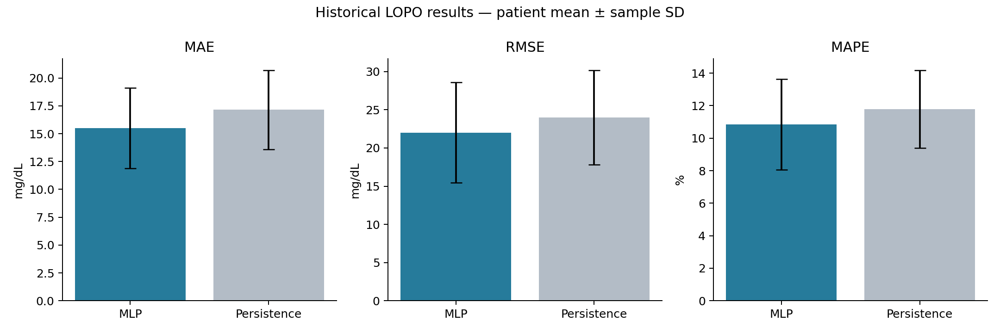
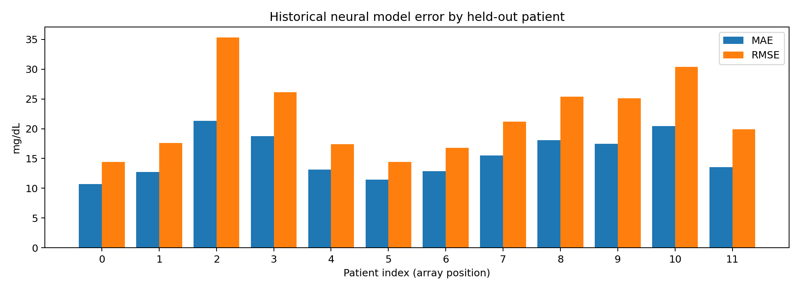
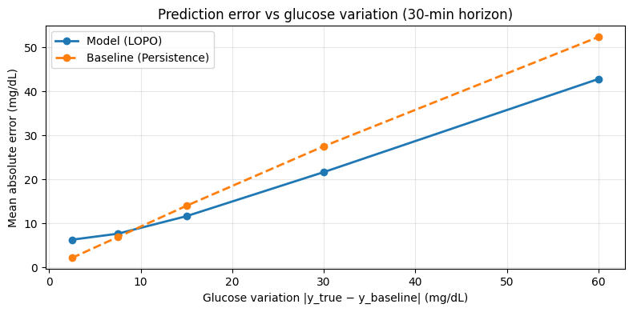

# 30-Minute Blood Glucose Forecasting from CGM Data

A university project investigating short-horizon glucose forecasting from continuous glucose monitoring (CGM) signals. MLP and LSTM architectures are compared with a persistence baseline using nested cross-validation with **Leave-One-Patient-Out (LOPO)** evaluation.

The saved experiment reports a mean **MAE of 15.488 mg/dL** and **RMSE of 22.015 mg/dL** across 12 held-out patients. These are historical results from the original notebook, not a new reproduction or results of the corrected protocol included here.

## Dataset and prediction task

The source notebook loads NumPy arrays containing timestamp–glucose pairs for 12 patients. The training array has shape `(12, 12641, 2)` and the additional test array `(12, 2897, 2)`. The reported LOPO experiment uses **only the training file**. Loading the separate test file does not constitute external validation.

The dataset's origin, participant consent and redistribution conditions are not documented in the supplied materials. Raw recordings, calendar dates and individual glucose trajectories are therefore excluded from this repository. Patient indices in performance summaries are array positions rather than identities.

| Forecast setting | Value |
|---|---|
| Sampling interval | 5 minutes |
| Input length | 24 glucose samples |
| Forecast horizon | 6 intervals, or 30 minutes |
| Window stride | 1 sample |
| Input shape | `(N, 24, 1)` |
| Target shape | `(N, 1)` |
| Output unit | mg/dL |

For a window starting at index `i`, the last input is at `i + 23` and the target at `i + 29`: the target is six intervals after the last input. The 24 observations form a two-hour sampling block; their first-to-last timestamp span is 115 minutes.

## Signal preprocessing

The original parser converts timestamps and glucose values, removes invalid records, sorts chronologically, keeps the last record for duplicate timestamps and constructs a five-minute grid. It then interpolates with a six-sample limit and removes remaining NaNs.

Auditing this implementation identified three issues: the interpolation limit partially fills longer missing runs; exact grid reindexing may discard off-grid observations; and dropping NaNs before index-based windowing permits windows to cross long gaps. The original window loop also omits the final valid start.

The notebook offers two explicit modes:

| Mode | Behaviour | Result status |
|---|---|---|
| `historical` | Preserves original preprocessing, windowing and final validation choices | Saved results below belong to this protocol |
| `corrected` (default) | Preserves original timestamps as interpolation anchors, fills only bounded gaps of at most six missing grid points, retains longer gaps, and checks continuity through the target | Requires a new training run |

Corrected mode also includes the final valid window. Six missing grid points correspond to 30 minutes of missing samples; the two bounding observations can be 35 minutes apart. Interpolation remains retrospective and may use future anchors, so this is not a demonstrated causal deployment pipeline.

## Neural models and baseline

| Model | Architecture |
|---|---|
| MLP | Flatten → Dense(128, ReLU) → Dropout(0.2) → Dense(64, ReLU) → Dense(1) |
| LSTM | LSTM(64) → Dropout(0.2) → Dense(32, ReLU) → Dense(1) |
| Persistence | Predict the final observed glucose value in the input window |

Both neural architectures use Adam and mean squared error loss. Inputs are standardised with a scalar mean and standard deviation; targets remain in mg/dL. Persistence is evaluated on the same held-out windows and targets as the neural model.

## Nested validation and model selection

The outer loop leaves one patient entirely out of model fitting and hyperparameter selection, repeating for all 12 patients. The inner loop uses five-fold `GroupKFold`, grouped by training-patient identity, and selects the configuration with the lowest mean validation RMSE.

| Candidate | Learning rate | Batch size |
|---|---:|---:|
| MLP | 0.001 | 256 |
| MLP | 0.0003 | 256 |
| LSTM | 0.001 | 256 |

Inner fits use at most 15 epochs with early-stopping patience 2. Final fits use at most 25 epochs with patience 3. Both monitor validation loss and restore the best weights. The full procedure comprises 180 inner fits and 12 final fits, or **192 fits**. All saved outer folds selected **MLP, learning rate 0.001, batch size 256**; the final results must not be attributed to the LSTM.

Inner standardisation uses fitting folds only. The historical final fit instead randomly reserves 10% of overlapping training windows for early stopping and fits the scaler before that split. This introduces validation dependence while keeping the outer patient excluded. Corrected mode reserves complete training patients via the first five-fold grouped split and fits scaling on its fitting subset. That change requires recalculating performance.

## Historical results

Values are **mean ± sample standard deviation across 12 patient-level metrics** (`ddof=1`), with equal patient weighting. They are not metrics pooled over all predictions, confidence intervals, or results from corrected mode.

| Metric | Selected neural model (MLP) | Persistence baseline |
|---|---|---|
| MAE (mg/dL) | 15.488 ± 3.612 | 17.154 ± 3.556 |
| RMSE (mg/dL) | 22.015 ± 6.552 | 23.995 ± 6.197 |
| MAPE (%) | 10.851 ± 2.784 | 11.791 ± 2.395 |

The mean MAE is lower by 1.666 mg/dL (about 9.7%), mean RMSE by 1.980 mg/dL (about 8.3%), and MAPE by 0.940 percentage points. These descriptive differences use rounded saved summaries and are not significance tests. MAPE uses a denominator floor of 1 mg/dL. The historical baseline summary was calculated after rounding patient metrics to three decimals.



This figure redraws the saved summary values; error bars are between-patient sample standard deviations. No new predictions or experiments were generated.

### Patient-level neural performance

| Patient index | MAE (mg/dL) | RMSE (mg/dL) | MAPE (%) |
|---|---:|---:|---:|
| 0 | 10.667 | 14.452 | 10.57 |
| 1 | 12.700 | 17.610 | 8.15 |
| 2 | 21.295 | 35.308 | 15.30 |
| 3 | 18.759 | 26.105 | 12.80 |
| 4 | 13.126 | 17.397 | 10.44 |
| 5 | 11.442 | 14.452 | 5.90 |
| 6 | 12.861 | 16.810 | 7.75 |
| 7 | 15.497 | 21.204 | 13.12 |
| 8 | 18.089 | 25.372 | 10.05 |
| 9 | 17.437 | 25.129 | 11.79 |
| 10 | 20.467 | 30.418 | 14.39 |
| 11 | 13.521 | 19.919 | 9.93 |



This chart redraws the rounded patient metrics saved in the original output. Patient variability is substantial. Numerical baseline metrics for each patient are not preserved in the available text output, so a claim that the model wins for every patient cannot be verified.

### Error and glucose variation



This figure is extracted unchanged from the original notebook. Its horizontal variable is `|true glucose − persistence prediction|`, which equals persistence absolute error by construction. The rising baseline curve is therefore expected. Bins exclude variation of 80 mg/dL or more. This exploratory plot alone does not demonstrate a clinical benefit during rapid changes.

Dated preprocessing comparisons and individual prediction/scatter plots are excluded from the public assets pending documented data-sharing permission.

## Repository contents

```text
cgm-glucose-forecasting/
├── CGM_Glucose_Forecasting.ipynb
├── README.md
├── requirements.txt
├── .gitignore
├── assets/results/           # Historical aggregate figures and provenance
└── docs/METHODOLOGY.md       # Protocol audit, changes and validation
```

## How to run

Use Python 3.10–3.12. TensorFlow 2.19.0 matches the version printed by the original notebook; the remaining dependency ranges are proposed rather than an exact recovered environment.

```bash
git clone https://github.com/ChiaraCenci/cgm-glucose-forecasting.git
cd cgm-glucose-forecasting
python -m venv .venv
# macOS / Linux:
source .venv/bin/activate
# Windows PowerShell instead:
# .venv\Scripts\Activate.ps1
pip install -r requirements.txt
jupyter lab
```

Obtain authorised copies of `glucose_level.npy` and optionally `glucose_level_test.npy`. Set `CGM_DATASET_ROOT` to their directory, or change `BASE_PATH` in the notebook. Object arrays use `allow_pickle=True`: load only trusted files. Optional Google Drive mounting is included for Colab. GPU use is optional but useful for training.

Choose `PROTOCOL = "corrected"` or `"historical"`, then run cells in order. A patient with no valid corrected test windows raises an error; insufficient eligible training patients can prevent five-fold grouped validation. Review data eligibility rather than silently reducing the cohort or assigning historical metrics to a changed experiment.

## Reproducibility and limitations

- Seeds are retained at 42. Exact numerical reproduction is not guaranteed across environments or training runs.
- The cohort contains only 12 patients, with unequal usable record lengths after preprocessing.
- Overlapping windows and historical gap handling affect dependence and temporal alignment. Corrected mode addresses specific implementation issues, but retrospective interpolation remains a possible look-ahead source.
- Patient-held-out validation is distinct from external institutional or prospective clinical validation. No clinical utility is established.
- The full LOPO procedure has not been rerun for this release. Code syntax, imports and targeted synthetic checks of gap handling, horizon alignment and window boundaries were checked; the pinned clean environment was not installed and validated.

See [the methodology audit](docs/METHODOLOGY.md) and [figure provenance](assets/results/PROVENANCE.md). The project is intended for research and educational documentation, not clinical use. Dataset redistribution rights remain unverified and no code licence has been selected.
